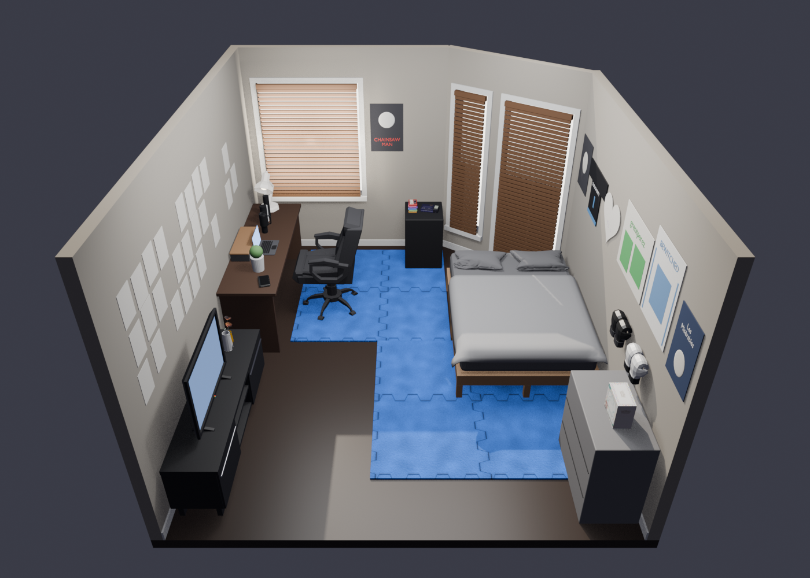

# Portfolio v2 — 3D Room

A stylized 3D diorama of my bedroom, built in Blender for an interactive three.js portfolio.
The room is generated by a Python script, so it can be rebuilt or tweaked at any time.



## Project structure

```
blender/
  build_my_room.py               # builds the whole room (walls, furniture, decor, imported models)
  my_room.glb                    # exported model for three.js
  my_room.blend                  # Blender file (regenerated on every build)
  my_room_preview.png            # overview render
  my_room_preview_door_side.png  # render from the bed toward the door wall
  assets/                        # third-party 3D models (see Credits)
  build_room.py, room.*          # earlier generic starter room
site/
  index.html, main.js            # three.js viewer (in-room look-around, clickable 3DS / SDAT, cassette picker)
  bedrock.js, pokemon.js         # Cobblemon (Bedrock) model loader + the wandering Pokémon
  assets/                        # Pokémon models, animations, textures, licenses
```

## Running the site

```bash
python3 -m http.server 8000   # from the repo root
```

Then open <http://localhost:8000/site/>. The page loads `../blender/my_room.glb`, so serve from the repo root
(or copy the .glb next to the page and change `ROOM_URL` in `site/main.js`).

The camera stands inside the room by the door: drag to look around, scroll to zoom.

- **Nintendo 3DS** (desk): lifts off, flies up to the camera, opens its lid and fades into
  [peteteaa.vercel.app](https://peteteaa.vercel.app).
- **SDAT player** (cabinet by the bed): same animation, into [sdat-beta.vercel.app](https://sdat-beta.vercel.app).
- **Cassette stack** (next to the SDAT): click it to step up to the cabinet and pick a song. The tape flies into the
  player and the track streams from the SDAT site. Picking another tape swaps them; Pause / Eject sit bottom right.
- **Pokémon 151 Elite Trainer Box** (grey dresser, to your right): click it to step up; the lid lifts off and is set
  down beside the black inner box, and five cards rise out and gather into a stack in front of you. **Fan out** /
  **Stack** (bottom right) switches the layout; click a card to hold it up close; **Put back**, clicking the box or Esc
  puts everything back.
- **Polaroids** (flat pile on the desk behind the 3DS): click the stack to step up to the desk; the top photo lifts up in
  front of you. **Next / Prev**, clicking the photo or the arrow keys flip through (each one goes back on the pile
  as the next comes up); **Put back** or Esc. The pictures are placeholders: give an entry in `PHOTOS`
  (`site/main.js`) a `src`, e.g. `"assets/photos/beach.jpg"`, and a `caption` to use your own (square crops look best).
- **Pokémon** (`site/pokemon.js`): Torchic, Ditto and Lucario wander the floor around the furniture; Torchic and Ditto
  sometimes hop up onto the bed for a walk on the blanket. Shiny Umbreon lounges on the foot of the bed. Poke any of
  them and it stops, turns to you, looks up at the camera and reacts (cry / happy / Umbreon's rings flare up).
  The Cobblemon Bedrock models and their Molang animations are loaded as-is by `site/bedrock.js`.

Visitors with reduced motion turned on go straight to the links.

## Building the room

Requires Blender 5.x (tested with 5.2 LTS).

```bash
/Applications/Blender.app/Contents/MacOS/Blender -b -P blender/build_my_room.py
```

This regenerates `my_room.blend`, `my_room.glb` and both preview renders. Room dimensions and
furniture positions are constants near the top of the script.

> Rebuilding overwrites `my_room.blend` — make changes in the script, not by hand in Blender.
> If Blender has the file open, use **File → Revert** after a rebuild before saving.

## Notes for three.js

The exported objects carry custom properties (glTF extras → `userData`):

| Property | Meaning |
|----------|---------|
| `userData.interactive` | Clickable objects: `laptop`, `laptop_display`, `tv`, `tv_screen`, `stanley_cup`, `vase`, `desk_lamp`, `chair`, `door`, `closet_mirror_door`, caps, gloves, posters, … |
| `userData.link` | URL to open on click — the 3DS (`nintendo_3ds`) links to `https://peteteaa.vercel.app`; the SDAT cassette player (`sdat_player`, on the cabinet by the bed) links to `https://sdat-beta.vercel.app` |
| `userData.hinge_axis`, `userData.open_angle` | On `nintendo_3ds_lid` and `sdat_lid`: rotate the lid by `open_angle` (radians) around `hinge_axis` (parent space) to open it |
| `userData.cassette`, `track_index`, `track_title`, `track_subtitle`, `track_src` | On `cassette_0`..`cassette_5` (the tape stack by the SDAT player; top-level, origin at the tape center, yaw-only rotation, canonical pose: lying flat, label up, long side along X). `track_src` is the mp3 URL on sdat-beta.vercel.app |
| `userData.bay_position`, `userData.bay_quaternion` | On `sdat_player`: world pose (three.js Y-up; position [x,y,z], quaternion [x,y,z,w]) to give a cassette object so it lies in the player's bay, label up under the lid window |
| `userData.etb`, `userData.etb_lid`, `userData.etb_card`, `lid_lift`, `lid_rest_position`, `lid_rest_quaternion`, `card_name`, `card_index`, `card_up`, `card_normal` | Pokémon TCG "Scarlet & Violet 151" Elite Trainer Box on the grey dresser (front faces -X). `etb` (interactive, origin bottom centre, no rotation) is the matte black inner box with two stacks of toploaders and a divider. Its child `etb_lid` is the whole printed outer box (origin at its centre, closed pose = no rotation): lift it straight up by `etb.lid_lift` metres to clear the box and cards, or move it to the pose `lid_rest_position` [x,y,z] / `lid_rest_quaternion` [x,y,z,w] (world, three.js coords; set down upright on the dresser at the +Y side). `etb_card_0`..`etb_card_4` are real cards standing upright as the front cards of the stacks (origin at card centre, identity rotation): `card_normal` = unit vector the face looks along (three.js [-1,0,0]), `card_up` = unit vector towards the top edge of the art (three.js [0,1,0]), `card_name` e.g. "Mew ex" |
| `userData.cutaway` | The near (door) wall and everything on it — hide/fade it when the camera is on that side |

- `laptop_display` and `tv_screen` are separate meshes for an `<Html>` overlay or a video texture.
- `nintendo_3ds_lid` is a child of `nintendo_3ds` with its origin on the hinge; it's exported closed.
- `sdat_lid` is a child of `sdat_player` (the user's own R3F model, exported from the sdat app; source `blender/assets/sdat_player.glb`) with its origin on the back hinge, exported closed. `hinge_axis` points to the player's right, `open_angle` is -1.85 rad (the app's lid angle).
- `door` has its origin at the hinge, so it can swing open by rotating around Z (Y in three.js).

## Credits

This project uses the following third-party 3D models. All CC-BY models require attribution,
which is provided here and also appears on the site (the **Credits** button, bottom left).
Models were rescaled, repositioned and in most cases recolored to match the room.

### Poly Pizza — CC-BY 3.0

| Model | Author | Source | Used for | File |
|-------|--------|--------|----------|------|
| Laptop | J-Toastie | [poly.pizza/m/UGOWjMUC5U](https://poly.pizza/m/UGOWjMUC5U) | Laptop on the desk | `laptop_jtoastie.glb` |
| Cap | J-Toastie | [poly.pizza/m/aWxhfEnYwl](https://poly.pizza/m/aWxhfEnYwl) | 4 caps on the door wall (recolored) | `cap_jtoastie.glb` |
| Boxing Gloves | Zsky | [poly.pizza/m/l2S6HNEpey](https://poly.pizza/m/l2S6HNEpey) | Black and white gloves (recolored) | `boxing_gloves.glb` |
| Executive Chair | Zsky | [poly.pizza/m/hW11P9DDXa](https://poly.pizza/m/hW11P9DDXa) | Desk chair | `executive_chair_zsky.glb` |
| Desk lamp | jeremy | [poly.pizza/m/4ScdjC1wytg](https://poly.pizza/m/4ScdjC1wytg) | White desk lamp by the window | `desk_lamp_jeremy.glb` |
| TV | Jarlan Perez | [poly.pizza/m/2flJebZTUrg](https://poly.pizza/m/2flJebZTUrg) | Flat-screen TV on the TV stand | `tv_jarlanperez.glb` |
| T-shirt | Poly by Google | [poly.pizza/m/bdOMzzh-fSl](https://poly.pizza/m/bdOMzzh-fSl) | Shirts hanging in the closet (recolored) | `tshirt_google.glb` |
| T-Shirts - folded | sirkitree | [poly.pizza/m/8HBhazMls_z](https://poly.pizza/m/8HBhazMls_z) | Folded stack on the closet shelf (recolored) | `tshirts_folded_sirkitree.glb` |

License: [Creative Commons Attribution 3.0](https://creativecommons.org/licenses/by/3.0/)

### Sketchfab — CC-BY 4.0

| Model | Author | Source | Used for | File |
|-------|--------|--------|----------|------|
| Stanley cup | Nate | [sketchfab.com/3d-models/stanley-cup-4a3368bb4f7b4726a0eb819f28fc63ff](https://sketchfab.com/3d-models/stanley-cup-4a3368bb4f7b4726a0eb819f28fc63ff) | Cup next to the laptop (recolored black) | `stanley_cup_nate.glb` |
| Nintendo 3DS XL | Joshua P. Pansdaz | [sketchfab.com/3d-models/nintendo-3ds-xl-6cf20040dc0e44559c3e69723945afcc](https://sketchfab.com/3d-models/nintendo-3ds-xl-6cf20040dc0e44559c3e69723945afcc) | 3DS on the desk (lid split off and closed, textures downscaled) | `nintendo_3ds_xl_pansdaz.glb` |

License: [Creative Commons Attribution 4.0](https://creativecommons.org/licenses/by/4.0/)

### Poly Haven — CC0 (public domain)

| Model | Author | Source | Used for | File |
|-------|--------|--------|----------|------|
| Throw Pillows 01 | Serhii Khromov | [polyhaven.com/a/throw_pillows_01](https://polyhaven.com/a/throw_pillows_01) | The two bed pillows (geometry only, recolored grey) | `throw_pillows_serhii_khromov.glb` |

License: [CC0](https://creativecommons.org/publicdomain/zero/1.0/). The bed blanket is a cloth simulation baked to a mesh inside `build_my_room.py`.

### Cobblemon — CC BY-NC 3.0

| Model | Author | Source | Used for | Files |
|-------|--------|--------|----------|-------|
| Torchic, Ditto, Lucario, Umbreon (shiny texture) | the Cobblemon team | [gitlab.com/cable-mc/cobblemon-assets](https://gitlab.com/cable-mc/cobblemon-assets/-/tree/master/blockbench/pokemon) | Pokémon hanging out in the room | `site/assets/<name>/` |

Unmodified Bedrock geometry, animations and textures, rendered by `site/bedrock.js`.
License: [Creative Commons Attribution-NonCommercial 3.0](https://creativecommons.org/licenses/by-nc/3.0/) — non-commercial use only.

### 3D Warehouse — General Model License

| Model | Author | Source | Used for | File |
|-------|--------|--------|----------|------|
| IKEA FRÖVÄXT vase | Shafhan S. | [3dwarehouse.sketchup.com/model/f43c7d9f-…](https://3dwarehouse.sketchup.com/model/f43c7d9f-edb5-4a44-81e9-cf97d93cbffa) | Vases with poppies next to the TV (scaled up) | `vase_frovaxt.glb` |

License: [3D Warehouse General Model License](https://3dwarehouse.sketchup.com/tos)

### Site credits text

> 3D models: "Laptop" and "Cap" by J-Toastie; "Boxing Gloves" and "Executive Chair" by Zsky; "Desk lamp" by jeremy;
> "TV" by Jarlan Perez; "T-shirt" by Poly by Google; "T-Shirts - folded" by sirkitree (Poly Pizza, CC-BY 3.0) ·
> "Stanley cup" by Nate; "Nintendo 3DS XL" by Joshua P. Pansdaz (Sketchfab, CC-BY 4.0) · "IKEA FRÖVÄXT vase" by Shafhan S. (3D Warehouse).

### Trademarks

IKEA and FRÖVÄXT are trademarks of Inter IKEA Systems B.V.; Stanley is a trademark of PMI Worldwide;
Nintendo 3DS is a trademark of Nintendo. Pokémon is a trademark of Nintendo, The Pokémon Company and GAME FREAK.
The Elite Trainer Box artwork (`blender/assets/etb151_*.jpg`, rectified from product photos) and the card images
(`blender/assets/cards151/`, from images.pokemontcg.io) are © Pokémon / Nintendo / Creatures / GAME FREAK, used for a
non-commercial fan portfolio. They're referenced only to describe the objects in the room.
This project is not affiliated with or endorsed by any of these companies.

Everything else (room shell, furniture, posters, closet, door and wall decor) was modeled procedurally
in `blender/build_my_room.py`.
